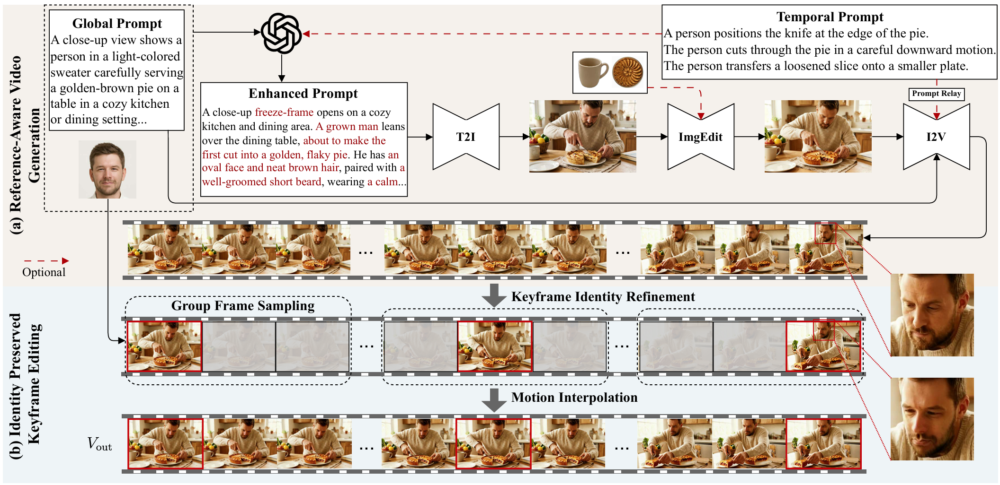

# KeyID: Decoupled Drafting and Keyframe Editing for Identity-Preserving Video Generation

ACM Multimedia 2026

Jianjie Luo, Yiming Zhong, Haoming Shen, Yupeng Xiao, Zhenguo Yang

[Paper](https://arxiv.org/abs/2608.16154) | [PDF](https://arxiv.org/pdf/2608.16154)

## Introduction

KeyID is a training-free framework for identity-preserving video generation that decouples motion synthesis from identity injection. It first generates a video draft conditioned on text prompts and subject references, then refines identity in sparse keyframes and reconstructs the final video through motion interpolation.

This repository supports Track1 and Track2 with Prompt Relay, covering single-subject, multi-subject, and sequential-action video generation.



## 1. Installation

Use Python 3.10+, CUDA, and FFmpeg. Run from the project root:

```bash
python -m pip install -e .
```

### External dependencies

Clone [LightX2V](https://github.com/ModelTC/LightX2V), [FaceFusion](https://github.com/facefusion/facefusion), and [LTX-2](https://github.com/Lightricks/LTX-2) alongside this repository:

```bash
git clone https://github.com/ModelTC/LightX2V.git ../LightX2V
git -C ../LightX2V checkout 3566cd5e1626965490debf91d36ea5cc11d71c46
git clone https://github.com/facefusion/facefusion.git ../facefusion
git -C ../facefusion checkout 519360bcd650679275024aa3ed10e8d673718bb3
git clone https://github.com/Lightricks/LTX-2.git ../LTX-2
git -C ../LTX-2 checkout 59ca828d5ae24358832ffd7003c2306fbceeba3a
```

Activate the corresponding Python environment before running each installation block:

```bash
# LightX2V environment
python -m pip install -r ../LightX2V/requirements.txt
python -m pip install PyYAML
```

```bash
# FaceFusion environment
(
  cd ../facefusion
  python install.py --onnxruntime cuda --skip-conda
)
python -m pip install PyYAML openai insightface
```

```bash
# LTX environment
python -m pip install ../LTX-2/packages/ltx-core ../LTX-2/packages/ltx-pipelines
python -m pip install PyYAML
```

### ERNIE environment

Install Diffusers following the [ERNIE-Image installation instructions](https://github.com/baidu/ERNIE-Image#diffusers):

```bash
# Run in the ERNIE environment
python -m pip install git+https://github.com/huggingface/diffusers
python -m pip install torch transformers accelerate Pillow PyYAML openai
```

### Qwen environment (Track2 only)

Install from source following the [DiffSynth-Studio installation instructions](https://github.com/modelscope/DiffSynth-Studio#installation). Dependencies are installed with the package:

```bash
# Run in the Qwen environment
git clone https://github.com/modelscope/DiffSynth-Studio.git ../DiffSynth-Studio
python -m pip install -e ../DiffSynth-Studio
python -m pip install PyYAML
```

## 2. Download Models

Run from the project root:

```bash
python -m pip install -U huggingface_hub
hf auth login
mkdir -p ckpts
```

Request access on the [Gemma model page](https://huggingface.co/google/gemma-3-12b-it-qat-q4_0-unquantized), then log in to Hugging Face to download the weights.

<table>
  <thead>
    <tr>
      <th>Stage</th>
      <th>Model</th>
      <th>Hugging Face</th>
      <th>Local directory</th>
    </tr>
  </thead>
  <tbody>
    <tr>
      <td>First frame</td>
      <td>ERNIE-Image-Turbo</td>
      <td><a href="https://huggingface.co/baidu/ERNIE-Image-Turbo">baidu/ERNIE-Image-Turbo</a></td>
      <td><code>ckpts/ERNIE-Image-Turbo/</code></td>
    </tr>
    <tr>
      <td rowspan="3">Video draft</td>
      <td>Wan configuration, T5, and VAE</td>
      <td><a href="https://huggingface.co/Wan-AI/Wan2.2-I2V-A14B/tree/main">Wan-AI/Wan2.2-I2V-A14B</a></td>
      <td><code>ckpts/Wan2.2-I2V-A14B/</code></td>
    </tr>
    <tr>
      <td>Wan high-noise 4-step 720p 260412</td>
      <td><a href="https://huggingface.co/lightx2v/Wan2.2-Distill-Models/blob/main/wan2.2_i2v_A14b_high_noise_lightx2v_4step_720p_260412.safetensors">Checkpoint</a></td>
      <td><code>ckpts/Wan2.2-Distill-Models/</code></td>
    </tr>
    <tr>
      <td>Wan low-noise 4-step 720p 260412</td>
      <td><a href="https://huggingface.co/lightx2v/Wan2.2-Distill-Models/blob/main/wan2.2_i2v_A14b_low_noise_lightx2v_4step_720p_260412.safetensors">Checkpoint</a></td>
      <td><code>ckpts/Wan2.2-Distill-Models/</code></td>
    </tr>
    <tr>
      <td rowspan="2">Face swap</td>
      <td>FaceFusion face swap and auxiliary models</td>
      <td><a href="https://huggingface.co/facefusion/models-3.0.0/tree/main">models-3.0.0</a>, <a href="https://huggingface.co/facefusion/models-3.1.0/tree/main">models-3.1.0</a>, <a href="https://huggingface.co/facefusion/models-3.3.0/tree/main">models-3.3.0</a></td>
      <td><code>ckpts/facefusion/</code></td>
    </tr>
    <tr>
      <td>SCRFD detector and buffalo_l detection/recognition models</td>
      <td><a href="https://huggingface.co/immich-app/buffalo_l">Immich buffalo_l mirror</a>; <a href="https://huggingface.co/immich-app/buffalo_l/blob/main/detection/model.onnx">Detection model</a>, <a href="https://huggingface.co/immich-app/buffalo_l/blob/main/recognition/model.onnx">Recognition model</a></td>
      <td><code>ckpts/antelopev2/</code>, <code>ckpts/insightface/models/buffalo_l/</code></td>
    </tr>
    <tr>
      <td rowspan="4">Motion interpolation</td>
      <td>LTX base model</td>
      <td><a href="https://huggingface.co/Lightricks/LTX-2.3/blob/main/ltx-2.3-22b-dev.safetensors">ltx-2.3-22b-dev.safetensors</a></td>
      <td><code>ckpts/LTX2.3/</code></td>
    </tr>
    <tr>
      <td>LTX distilled LoRA</td>
      <td><a href="https://huggingface.co/Lightricks/LTX-2.3/blob/main/ltx-2.3-22b-distilled-lora-384.safetensors">ltx-2.3-22b-distilled-lora-384.safetensors</a></td>
      <td><code>ckpts/LTX2.3/</code></td>
    </tr>
    <tr>
      <td>LTX spatial upscaler</td>
      <td><a href="https://huggingface.co/Lightricks/LTX-2.3/blob/main/ltx-2.3-spatial-upscaler-x2-1.1.safetensors">ltx-2.3-spatial-upscaler-x2-1.1.safetensors</a></td>
      <td><code>ckpts/LTX2.3/</code></td>
    </tr>
    <tr>
      <td>Gemma text encoder</td>
      <td><a href="https://huggingface.co/google/gemma-3-12b-it-qat-q4_0-unquantized">google/gemma-3-12b-it-qat-q4_0-unquantized</a></td>
      <td><code>ckpts/LTX2.3/gemma-3-12b-it-qat-q4_0-unquantized/</code></td>
    </tr>
    <tr>
      <td rowspan="2">First frame edit</td>
      <td>Qwen editing model (Track2 only)</td>
      <td><a href="https://huggingface.co/Qwen/Qwen-Image-Edit-2511">Qwen/Qwen-Image-Edit-2511</a></td>
      <td><code>ckpts/Qwen-Image-Edit-2511/</code></td>
    </tr>
    <tr>
      <td>Qwen 4-step BF16 LoRA (Track2 only)</td>
      <td><a href="https://huggingface.co/lightx2v/Qwen-Image-Edit-2511-Lightning/blob/main/Qwen-Image-Edit-2511-Lightning-4steps-V1.0-bf16.safetensors">Checkpoint</a></td>
      <td><code>ckpts/</code></td>
    </tr>
  </tbody>
</table>

### ERNIE and Wan

```bash
hf download baidu/ERNIE-Image-Turbo \
  --local-dir ckpts/ERNIE-Image-Turbo

hf download Wan-AI/Wan2.2-I2V-A14B \
  configuration.json high_noise_model/config.json low_noise_model/config.json \
  Wan2.1_VAE.pth models_t5_umt5-xxl-enc-bf16.pth \
  --local-dir ckpts/Wan2.2-I2V-A14B

hf download Wan-AI/Wan2.2-I2V-A14B \
  --include 'google/**' \
  --local-dir ckpts/Wan2.2-I2V-A14B

hf download lightx2v/Wan2.2-Distill-Models \
  wan2.2_i2v_A14b_high_noise_lightx2v_4step_720p_260412.safetensors \
  wan2.2_i2v_A14b_low_noise_lightx2v_4step_720p_260412.safetensors \
  --local-dir ckpts/Wan2.2-Distill-Models
```

### FaceFusion

```bash
for name in 2dfan4 fan_68_5 arcface_w600k_r50 bisenet_resnet_34 \
            fairface inswapper_128 kim_vocal_2 yoloface_8n; do
  hf download facefusion/models-3.0.0 "${name}.onnx" "${name}.hash" \
    --local-dir ckpts/facefusion
done

hf download facefusion/models-3.1.0 xseg_1.onnx xseg_1.hash \
  --local-dir ckpts/facefusion

hf download facefusion/models-3.3.0 \
  nsfw_1.onnx nsfw_1.hash nsfw_2.onnx nsfw_2.hash nsfw_3.onnx nsfw_3.hash \
  --local-dir ckpts/facefusion
```

### SCRFD and buffalo_l

```bash
hf download immich-app/buffalo_l detection/model.onnx recognition/model.onnx \
  --local-dir ckpts/.downloads/buffalo_l

mkdir -p ckpts/antelopev2 ckpts/insightface/models/buffalo_l
cp ckpts/.downloads/buffalo_l/detection/model.onnx \
  ckpts/antelopev2/scrfd_10g_bnkps.onnx
cp ckpts/.downloads/buffalo_l/detection/model.onnx \
  ckpts/insightface/models/buffalo_l/det_10g.onnx
cp ckpts/.downloads/buffalo_l/recognition/model.onnx \
  ckpts/insightface/models/buffalo_l/w600k_r50.onnx
```

### LTX and Gemma

```bash
hf download Lightricks/LTX-2.3 \
  ltx-2.3-22b-dev.safetensors \
  ltx-2.3-22b-distilled-lora-384.safetensors \
  ltx-2.3-spatial-upscaler-x2-1.1.safetensors \
  --local-dir ckpts/LTX2.3

hf download google/gemma-3-12b-it-qat-q4_0-unquantized \
  --local-dir ckpts/LTX2.3/gemma-3-12b-it-qat-q4_0-unquantized
```

### Qwen (Track2 only)

```bash
hf download Qwen/Qwen-Image-Edit-2511 \
  --local-dir ckpts/Qwen-Image-Edit-2511

hf download lightx2v/Qwen-Image-Edit-2511-Lightning \
  Qwen-Image-Edit-2511-Lightning-4steps-V1.0-bf16.safetensors \
  --local-dir ckpts
```

### Checkpoint layout

```text
├── configs/
│   ├── pipeline.track1.local.yaml
│   ├── pipeline.track2.local.yaml
│   └── wan22.i2v.4step.local.json
├── ckpts/
│   ├── ERNIE-Image-Turbo/                         # Full model directory
│   ├── Wan2.2-I2V-A14B/                           # Full model directory
│   ├── Wan2.2-Distill-Models/
│   │   ├── wan2.2_i2v_A14b_high_noise_lightx2v_4step_720p_260412.safetensors
│   │   └── wan2.2_i2v_A14b_low_noise_lightx2v_4step_720p_260412.safetensors
│   ├── facefusion/                               # Place .onnx and .hash files here
│   ├── antelopev2/
│   │   └── scrfd_10g_bnkps.onnx
│   ├── insightface/
│   │   └── models/
│   │       └── buffalo_l/
│   │           ├── det_10g.onnx                   # Detection
│   │           └── w600k_r50.onnx                 # Recognition
│   ├── LTX2.3/
│   │   ├── ltx-2.3-22b-dev.safetensors
│   │   ├── ltx-2.3-22b-distilled-lora-384.safetensors
│   │   ├── ltx-2.3-spatial-upscaler-x2-1.1.safetensors
│   │   └── gemma-3-12b-it-qat-q4_0-unquantized/     # Full model directory
│   ├── Qwen-Image-Edit-2511/                      # Track2 only; full model directory
│   └── Qwen-Image-Edit-2511-Lightning-4steps-V1.0-bf16.safetensors
└── scripts/run.sh
```

## 3. Prepare Data

### Track1

Prepare metadata containing `img` and `prompt` fields and the corresponding portrait references:

```bash
python tools/prepare_track1.py \
  --metadata /path/to/track1/eval.json \
  --image-root /path/to/track1/images \
  --output-dir inputs/track1
```

This creates `inputs/track1/metadata.json` and `inputs/track1/images/person/`.

### Track2

Prepare the Track2 metadata and reference images:

```bash
python tools/prepare_track2.py \
  --metadata /path/to/track2/eval.json \
  --image-root /path/to/track2/images \
  --output-dir inputs/track2
```

This creates `inputs/track2/eval.json` and category-based references under `inputs/track2/images/`, preserving reference order, global prompts, and temporal captions.

## 4. Configuration

Copy the configuration files:

```bash
cp configs/pipeline.track1.yaml configs/pipeline.track1.local.yaml
cp configs/pipeline.track2.yaml configs/pipeline.track2.local.yaml
cp configs/wan22.i2v.4step.json configs/wan22.i2v.4step.local.json
```

Edit `pipeline.track1.local.yaml` or `pipeline.track2.local.yaml` for the track you want to run:

| Field | Value |
| --- | --- |
| `credentials.openai.api_key` | API Key |
| `endpoints.openai.base_url` | Service URL supporting the Responses API and image inputs |
| `stages.head_extract.params.model_name` | Vision model name |
| `stages.prompt_compose.params.model_name` | Text model name |
| `stages.face_binding.params.model_name` | Vision model name |
| `dataset.root` | Dataset root directory |
| `dataset.metadata` | Path to the metadata JSON |
| `stages.draft_video.params.lightx2v_path` | Absolute path to the LightX2V repository |
| `stages.face_swap.params.facefusion_path` | Absolute path to the FaceFusion repository |
| `stages.interpolation.params.ltx_path` | Absolute path to the LTX-2 repository |
| `stages.draft_video.params.config_json` | `../configs/wan22.i2v.4step.local.json` |
| `stages.object_edit.params.reference_root` (Track2) | Same as `dataset.root` |

Set each stage's `python` field to the absolute path of its environment's Python interpreter:

| Field | Python environment |
| --- | --- |
| `stages.prompt_pe.python` | ERNIE |
| `stages.head_extract.python` | Environment with the OpenAI SDK, such as ERNIE |
| `stages.prompt_compose.python` | Environment with the OpenAI SDK, such as ERNIE |
| `stages.first_frame.python` | ERNIE |
| `stages.draft_prompt.python` | Environment with PyYAML, such as ERNIE |
| `stages.draft_video.python` | LightX2V |
| `stages.face_binding.python` | Environment with the OpenAI SDK, InsightFace, OpenCV, and GPU ONNX Runtime |
| `stages.face_swap.python` | FaceFusion |
| `stages.keyframe_select.python` | Environment with InsightFace and GPU ONNX Runtime, such as FaceFusion |
| `stages.interpolation.python` | LTX |
| `stages.object_edit.python` (Track2 only) | Qwen-Image-Edit / DiffSynth |

Place models under `ckpts/` as shown above and keep the relative checkpoint paths in the templates.

## 5. Run

Run from the project root.

Track1:

```bash
bash scripts/run.sh configs/pipeline.track1.local.yaml
```

Track2:

```bash
bash scripts/run.sh configs/pipeline.track2.local.yaml
```

Output videos:

```text
outputs/workspaces/track1/stages/interpolation/items/<sample_id>/video.mp4
outputs/workspaces/track2/stages/interpolation/items/<sample_id>/video.mp4
```

## Citation

If you find this project useful for your research, please cite:

```bibtex
@misc{luo2026keyid,
  title={KeyID: Decoupled Drafting and Keyframe Editing for Identity-Preserving Video Generation},
  author={Jianjie Luo and Yiming Zhong and Haoming Shen and Yupeng Xiao and Zhenguo Yang},
  year={2026},
  eprint={2608.16154},
  archivePrefix={arXiv},
  primaryClass={cs.CV},
  url={https://arxiv.org/abs/2608.16154}
}
```
